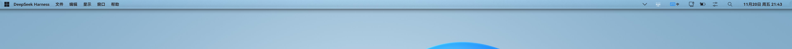
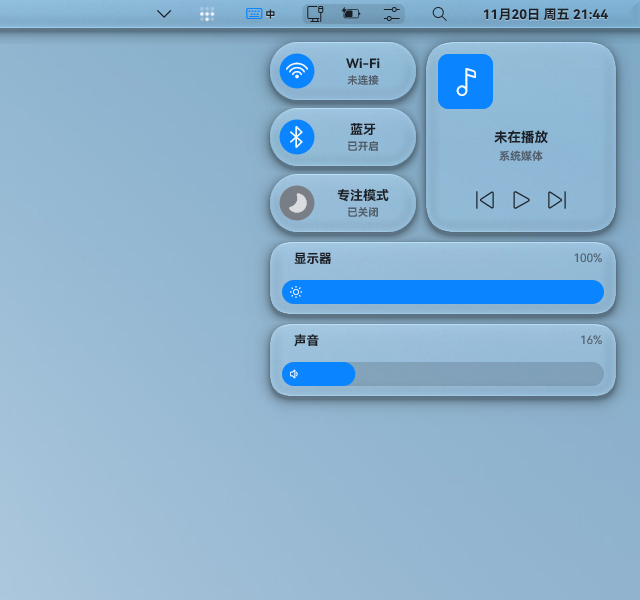
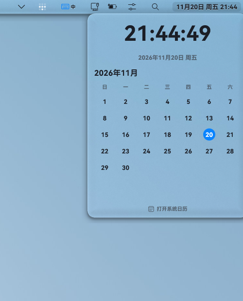
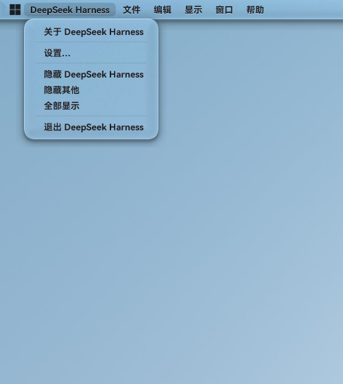
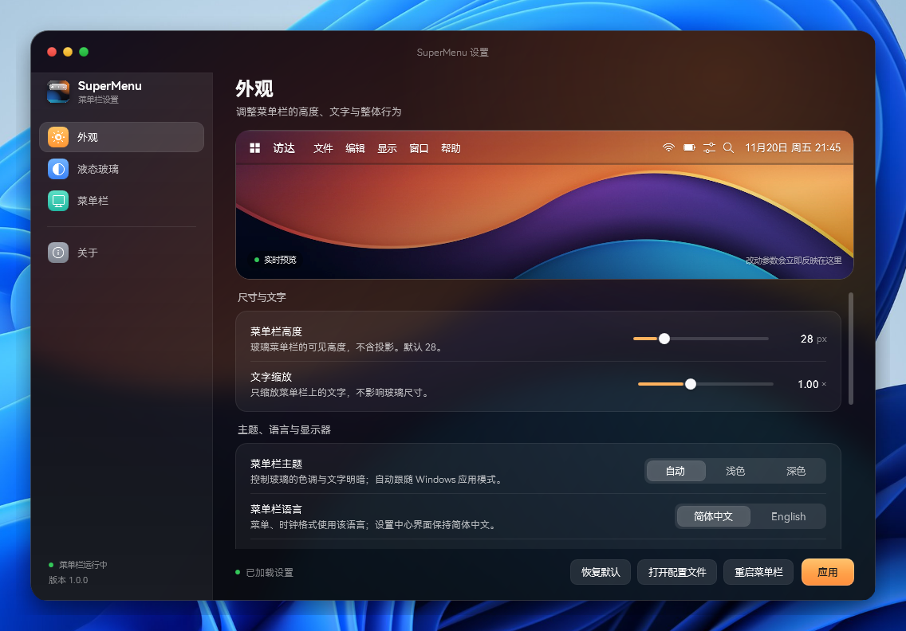

# SuperMenu

Windows 11 上的 macOS 风格顶部菜单栏：液态玻璃、原生 Win32 + DirectComposition、
可选的 Atrium 托盘宿主，以及一个用 WPF 编写的设置中心。



> 当前版本：**1.0.0** · Windows x64 · 便携版（解压即用） · **MIT License**

## 功能

- **macOS 风格菜单栏**：Apple / Windows 标志、当前应用名、文件 / 编辑 / 显示 /
  窗口 / 帮助菜单；菜单与面板均为自绘玻璃，不调用系统原生菜单。
- **液态玻璃**：Desktop Duplication 实时取景，mip 模糊、G3 连续圆角、边缘折射、
  色散、高光、颗粒与亮度自适应墨色；参数可在设置中心细调。
- **右侧状态区**：网络（Ethernet / Wi-Fi / 离线）、电池（AC 时带 ⚡）、控制中心、
  搜索、日期与时钟；布局每帧保留悬停渐变，不闪烁。
- **控制中心**：Wi‑Fi / 蓝牙 / 专注模式开关、亮度与音量端点式滑杆、媒体播放卡片。
- **日期时间**：点击时钟打开秒级数字时钟与迷你日历，标题包含年份；点击日历区域
  打开 Windows 任务栏日历。
- **系统托盘（Atrium trayHost）**：隐藏的 `Shell_TrayWnd` 抢在 Explorer 前接收
  `Shell_NotifyIcon`，保存实时 HICON、tooltip、回调消息与版本，转发给 Explorer；
  左/右键按 shell 协议直接发给应用，隐藏图标也能直接交互。另有 Explorer 读取回退。
- **输入法状态**：跟随系统键盘布局显示 `中/英`、`あ/A`、`한/A`、`ENG` 或语言缩写，
  点击打开 Windows 键盘布局切换菜单。
- **Windows 更新提示**：检测 CBS / Windows Update 待重启键，在状态块左侧显示
  蓝色更新图标，点击打开 Windows 更新。
- **隐私提示**：参考 macOS 控制中心，在日期右侧显示橙色麦克风 / 绿色摄像头圆点；
  读取 Camera FrameServer 与 WASAPI 活跃会话，仅在设备占用时出现，不改变日期位置。
- **通知与个性化**：通知中心面板、应用名跟随前台、桌面聚焦隐藏菜单、自动隐藏、
  全屏应用避让、可选 AppBar 工作区预约。
- **开机自启**：设置中心开启后创建当前用户的登录计划任务，早于普通 Run 项启动；
  任务创建失败自动回退 HKCU Run。
- **界面字体**：内嵌 HarmonyOS Sans SC 四个字重（Light/Regular/Medium/Bold），
  私有加载，图标仍使用 Segoe Fluent Icons。

## 截图

| | |
|---|---|
|  |  |
|  |  |

更多截图见 [`docs/screenshots`](docs/screenshots)。

## 系统要求

- Windows 11 x64（Windows 10 19041+ 可运行，部分玻璃/隐私能力受限）
- 设置中心与媒体 helper 需要 **.NET 10 Desktop Runtime**
  （`Microsoft.WindowsDesktop.App 10.x`）
- 原生菜单栏仅依赖系统 DLL，不需要 Visual C++ 运行库

## 快速开始

1. 解压发行版 zip 到任意目录（不要只从压缩包里直接运行）。
2. 运行 `SuperMenuBar.exe`。
3. 设置中心：右键顶栏或托盘图标 → **打开 SuperMenu 设置**，或运行
   `Settings\SuperMenu.Settings.exe`。
4. 默认不创建开机启动；需要时在设置中心开启“开机自动启动”。

首次启动会创建：

- 设置：`%LOCALAPPDATA%\SuperMenu\settings.json`
- 日志：`%LOCALAPPDATA%\SuperMenu\logs\supermenu.log`

退出：Apple 菜单 → **退出 SuperMenu**。正常退出会释放 AppBar 预约与托盘宿主，
桌面工作区自动恢复。

## 设置与自定义

设置中心包含外观、液态玻璃、菜单栏、关于四页，可调整：

- 主题、玻璃预设、透明度 / 模糊 / 折射 / 色散 / 高光 / 阴影 / 色调
- 菜单栏高度、字体缩放、日期与时钟、右侧图标间距
- 顶部 / 隐藏托盘图标、开机自启
- 左侧 Apple / Windows / Windows mono 标志

设置通过 `%LOCALAPPDATA%\SuperMenu\settings.json` 持久化，原生栏热重载。
字段与范围见 [`docs/settings-schema.md`](docs/settings-schema.md)。

## 构建

### 环境

- Windows 11
- [MSYS2 UCRT64](https://www.msys2.org/)：GCC、CMake ≥ 3.25、Ninja
- .NET 10 SDK

### 一键构建

仓库根目录执行：

```powershell
.\build.ps1 -Version 1.0.0
```

脚本会：

1. 检查 MSYS2 UCRT64 / CMake / Ninja / .NET SDK；
2. 构建原生 C++ 菜单栏；
3. 发布 WPF 设置中心与媒体 helper；
4. 组装 `dist/`；
5. 运行设置中心 `--selftest`，要求 27/27；
6. 生成便携发行目录与
   `release/SuperMenu-1.0.0-win-x64.zip`，并写入 SHA-256。

常用参数：

```powershell
.\build.ps1 -Clean                 # 清理 native/build、dist、release 后重建
.\build.ps1 -SkipZip               # 只构建，不打包 zip
.\build.ps1 -SkipBuild             # 用当前 dist 重新打包
.\build.ps1 -Version 1.0.1         # 指定发行版本号
```

底层构建脚本仍是 [`scripts/build.ps1`](scripts/build.ps1)：

```powershell
.\scripts\build.ps1 -Zip
```

完整工具链安装与排错见 [`docs/BUILD.md`](docs/BUILD.md)。

## 发行包内容

```text
SuperMenu-1.0.0-win-x64/
├─ SuperMenuBar.exe
├─ Fonts/                 HarmonyOS Sans SC + Segoe Fluent Icons + 字体许可
├─ Settings/              WPF 设置中心（.NET 10，框架依赖）
├─ Media/                 SMTC 媒体 helper（.NET 10）
├─ docs/
├─ README.md
├─ LICENSE
└─ THIRD_PARTY_NOTICES.md
```

## 项目结构

| 目录 | 内容 |
|---|---|
| `native/` | C++20 Win32 菜单栏、DirectWrite/D2D/DComp 玻璃渲染、Atrium trayHost |
| `settings/` | C# / WPF 设置中心 |
| `media/` | .NET 10 WinRT SMTC 媒体 helper |
| `assets/` | 字体、图标、标志、壁纸 |
| `docs/` | 设计、架构、托盘、构建、验证与截图 |
| `scripts/` | 底层构建脚本 |

## 已知边界

- 托盘宿主需要在没有其他 tray host 抢在前面的情况下工作；检测到 Atrium /
  RetroBar 等宿主时会让位并回退 Explorer 读取。
- 提升权限应用可能拒绝普通权限托盘宿主发送的回调，此时回退系统托盘路径。
- 全屏 / HDR / 受保护桌面上 Desktop Duplication 可能不可用，玻璃回退为壁纸背景。
- 目前为单显示器菜单栏；切换显示器或 DPI 后请重启菜单栏。

## 数据与隐私

SuperMenu 不联网、不收集遥测。除用户主动打开的 Windows 设置 / 系统功能外，
仅在本机读写自己的设置、日志和托盘快照。隐私提示只读取 Windows 的设备占用状态，
不记录麦克风/摄像头内容。

## 致谢

特别感谢 [Atrium Desktop](https://github.com/wynter-yaxley/atrium-desktop) 项目及其
贡献者。SuperMenu 的液态玻璃渲染参数、托盘宿主（`trayHost`）架构和大量 Windows
Shell 交互经验都来自 Atrium；没有这个项目，就不会有当前这版 SuperMenu。

同时感谢：

- **HarmonyOS Sans SC**：Huawei Device Co., Ltd. 与 Hanyi Fonts
- **Segoe Fluent Icons / Windows 11**：系统图标与视觉参考
- 所有参与测试、反馈和提供建议的用户

Atrium 以 MIT License 发布；SuperMenu 中适配自 Atrium 的源码与许可说明见
[`THIRD_PARTY_NOTICES.md`](THIRD_PARTY_NOTICES.md)。

## 许可

- SuperMenu 本体：**[MIT License](LICENSE)**（本项目源代码采用 MIT 许可证）
- Atrium Desktop trayHost（MIT）：见 [`THIRD_PARTY_NOTICES.md`](THIRD_PARTY_NOTICES.md)
- HarmonyOS Sans SC：© Huawei Device Co., Ltd. & Hanyi Fonts，
  HarmonyOS Sans Fonts License；
  完整协议见 [`assets/fonts/LICENSE-HarmonyOS-Sans.txt`](assets/fonts/LICENSE-HarmonyOS-Sans.txt)

设计与 Apple macOS 无关联。
