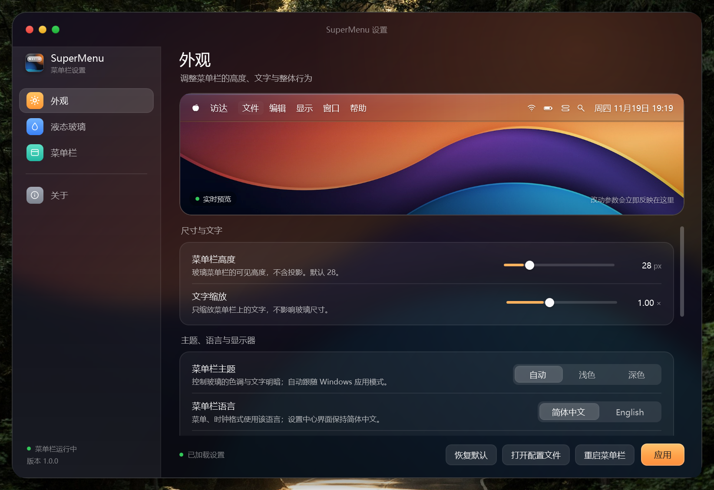

# SuperMenu 设置中心（SuperMenu.Settings）

macOS 风格 Windows 菜单栏 **SuperMenu** 的配套设置应用。WPF / .NET 10 / x64，无任何第三方 NuGet 依赖，
自带 HarmonyOS Sans SC 字体与壁纸，界面上方是随参数实时变化的菜单栏玻璃预览。



- **界面**：自定义窗口（圆角、手绘投影、左上角交通灯）、侧边栏导航、玻璃卡片、胶囊开关、自定义滑块、
  分段控件、色调色板、状态浮层（toast）；全部文案为简体中文，使用 HarmonyOS Sans SC
（四个字重私有加载，不安装到系统）。
- **实时预览**：模拟 macOS 菜单栏，直接响应 `barHeight`、`fontScale`、主题/语言、模块开关（含最左侧的苹果 / Windows 图标）、透明度、
  模糊、折射、边缘宽度、色散、高光、阴影、色调等设置；含菜单悬停高亮与缓慢移动的镜面光。
- **系统托盘定制**（菜单栏页）：只读 `HKCU\Control Panel\NotifyIconSettings`，并读取原生栏写出的
  `tray-live.txt` 存活快照，只把当前真正存在的通知区域图标（本机 15 个）列成两列清单；
  行图标优先用 `ExtractIconEx` 从运行 exe 提取实际应用图标，失败才回退 Explorer 快照。
  每个图标一个胶囊开关。`trayShow` / `trayHide` 两个覆盖列表按
  「hide > show > Windows IsPromoted」生效，`rightIconSpacing` 控制右侧状态图标与小托盘图标的间距。
  支持「刷新图标」和「恢复系统默认」。设置中心只读取注册表与存活快照，绝不注册/修改托盘图标
  （渲染由原生菜单栏负责）。
- 最左侧图标支持苹果、彩色 Windows、黑白 Windows（`windows-mono`）三种图形。
- **原生集成**：只做两件事——写共享设置文件、广播刷新消息；不发明任何 socket / IPC 协议。

> 设置文件契约以 [`docs/settings-schema.md`](../docs/settings-schema.md) 为唯一事实来源。

## 构建 / 运行 / 发布

需要 Windows 10/11、.NET 10 SDK（本机验证 10.0.404）与 WindowsDesktop 运行时 10（本机 10.0.15）。
以下命令都在 `settings\SuperMenu.Settings` 目录执行：

```powershell
cd C:\fish\git\kevison-supermenu\settings\SuperMenu.Settings

# 1. 构建（x64，Debug）
dotnet build

# 2. 直接运行
dotnet run

# 3. 发布（框架依赖、win-x64；产物是整个 publish 文件夹，必须整体分发）
dotnet publish -c Release -r win-x64 --self-contained false -o ..\publish
```

- 构建产物：`settings\SuperMenu.Settings\bin\Debug\net10.0-windows\SuperMenu.Settings.exe`
- 发布产物：`settings\publish\SuperMenu.Settings.exe`（约 33 MB，主要是 4 个 HarmonyOS Sans SC TTF）
- **分发时必须复制整个 `publish` 文件夹**（含 `Assets\Fonts\*.otf`）。只复制 exe 时应用仍可启动：
  字体会回退到 Segoe UI Variable / 微软雅黑，壁纸回退为纯色渐变，但不会崩溃。

### 与菜单栏一起分发（dist 布局）

```
dist\
  SuperMenuBar.exe              ← 原生菜单栏（native 构建产物）
  Settings\
    SuperMenu.Settings.exe      ← 本应用（publish 文件夹的全部内容复制到这里）
    Assets\Fonts\...
    ...
```

设置中心会以此为基准查找菜单栏：`AppContext.BaseDirectory`、`..\SuperMenuBar.exe`、逐级父目录，
以及 `dist\`、`native\build\dist\`、`build\Release\` 等常见布局；找不到时只是隐藏“重启菜单栏”按钮，
不会报错或崩溃。发布版实测可从 `settings\publish` 找到 `native\build\dist\SuperMenuBar.exe`。

## 设置文件契约

- 路径：`%LOCALAPPDATA%\SuperMenu\settings.json`（UTF-8，扁平 camelCase JSON；键与默认值见 schema 文档）。
- 启动时读取；文件不存在时写入默认值。缺失/类型错误/越界的键一律回退默认值并夹紧到合法范围，
  坏 JSON 不会崩溃（界面提示“配置文件格式有误，已加载默认值”）。
- **保存是原子的**：先写同目录临时文件并 `Flush(true)`，再用 `File.Replace`（不支持时退回 `File.Move`）覆盖，
  原生侧不会读到半截文件。保存后通过
  `RegisterWindowMessageW("SuperMenu.SettingsChanged")` + `PostMessageW(HWND_BROADCAST, ...)` 通知刷新。
- schema 之外的未知键会在读取后保留，保存时原样写回，方便将来扩展。
- 不向该文件写入任何 UI 状态（窗口位置、上次页面等全部不持久化）。
- `launchAtLogin` 只写入设置文件；原生菜单栏会创建当前用户的“登录时”计划任务
  （比 HKCU Run 更早启动），任务创建失败时才回退到 HKCU Run。设置中心不碰注册表或任务计划。

## 测试与开发辅助

```powershell
# 无界面自检：契约/默认值/原子保存/轮转/未知键保留/非法 JSON/预设/字体/壁纸/原生查找/托盘目录
# 结果写入指定 JSON，退出码 0 = 全部通过（测试只使用临时文件，不碰真实设置）
.\bin\Debug\net10.0-windows\SuperMenu.Settings.exe --selftest ..\screenshots\selftest.json

# 从任意页面启动（默认 appearance）：appearance | glass | menubar | about
.\bin\Debug\net10.0-windows\SuperMenu.Settings.exe --page glass

# 仅用于自动化测试：覆盖设置文件路径（正式运行时不要设置）
$env:SUPERMENU_SETTINGS_PATH = "$env:TEMP\supermenu-test\settings.json"
```

`settings\tools\` 下的脚本：

| 脚本 | 用途 |
| --- | --- |
| `generate-icon.ps1` | 重新生成 `Assets\SuperMenu.ico` / `Assets\appicon.png`（System.Drawing 绘制，无外部依赖） |
| `capture.ps1` | 启动应用、截取窗口 PNG（可指定 `-Page`、`-SettingsPath`），用于视觉验证 |
| `test-ui-roundtrip.ps1` | UI Automation 端到端测试：切换开关/选择玻璃预设/输入色调 → 点“应用” → 断言 JSON 落盘 |
| `test-tray.ps1` | UI Automation 端到端测试：断言当前存活托盘图标列表、切换托盘开关/移动间距滑块 → 点“应用” → 断言 `trayShow`/`trayHide`/`rightIconSpacing` 落盘，并验证「刷新图标」「恢复系统默认」 |
| `test-window-chrome.ps1` | 无边框窗口测试：NC 命中测试（拖动/四边四角缩放）与最大化工作区、还原尺寸 |

已验证结果（本机 2560×1440 逻辑屏、150% 缩放）：

- `dotnet build`（清理 bin/obj 后）0 警告 0 错误。
- `--selftest`：27 项全部通过（含 38 个 schema 键齐全、未知键保留、非法值夹紧、HarmonyOS Sans 私有加载、只读托盘目录）。
- 托盘目录：原始 37 条注册表记录 → 排除 SuperMenu 自己的 2 条、按「相同快照 + 相同标签」去重 2 条
  → 33 条持久化记录；叠加原生 `tray-live.txt` 存活快照后本机当前为 **15 个**（1 显示 / 14 隐藏），
  全部 15 个快照 PNG 解码成功，整次读取约 12–30 ms。菜单栏未运行时快照过期，会显示历史记录并提示。
- 托盘 UI 端到端：强制一个隐藏图标显示 → 落盘 `trayShow=<id>`；强制一个显示图标隐藏 → 落盘 `trayHide=<id>`；
  「恢复系统默认」→ 两个列表清空为 `""`；`rightIconSpacing` 滑块 12 → 20 落盘；38 个键齐全，ID 列表按数值排序。
- UI 端到端：开关 On→Off 后写入 `reserveWorkArea=false`；预设“透明”落盘 `glassPreset=clear`、
  `blur=0.1`、`dispersion=0.55`；色调输入 `#FFCC88` 落盘一致。
- 原生集成：菜单栏进程运行时会显示“运行中”并定位到 `native\build\dist\SuperMenuBar.exe`。
- 无 Assets 目录时仍能正常启动（字体/壁纸回退）。

## 目录结构

```
settings\
  SuperMenu.Settings\
    App.xaml(.cs)                 应用入口、资源字典合并、--selftest 分发
    MainWindow.xaml(.cs)          窗口、四个页面、实时预览、应用/恢复/重启、toast
    Models\AppSettings.cs         38 个 schema 键的强类型模型、默认值/夹紧/未知键保留/玻璃预设/托盘覆盖规则
    Models\TrayIconRow.cs         系统托盘清单的行视图模型（图标、标签、显示/隐藏开关）
    Services\SettingsStore.cs     容错读取、原子保存、路径解析
    Services\TrayCatalog.cs       只读 Windows 11 通知区域注册表：UIOrderList 排序、路径/标签清洗、去重、PNG 解码
    Services\NativeBridge.cs      菜单栏定位、重启、HWND_BROADCAST 刷新消息、打开配置文件
    Services\AppAssets.cs         HarmonyOS Sans 私有加载、内嵌壁纸、预览色调亮度采样、系统主题检测
    Services\SelfTest.cs          无界面契约自检（27 项，含只读托盘目录检查）
    Controls\SegmentedControl.*   带滑动胶囊的 macOS 风格分段控件
    Resources\Theme.xaml          调色板、字体、排版样式
    Resources\Controls.xaml       开关、滑块、按钮、交通灯、导航、滚动条、文本框等全部自定义样式
    Assets\Fonts\                 HarmonyOS Sans SC Light/Regular/Medium/Bold（未修改，随应用私有加载）
    Assets\Backgrounds\           flow.jpg（预览/窗口壁纸，已内嵌进程序集）
    Assets\SuperMenu.ico          应用图标（由 tools\generate-icon.ps1 生成）
  publish\                        发布产物（框架依赖 win-x64，整体分发）
  screenshots\                    四页界面截图与自检结果
  screens\                        UI 自动化测试截图与托盘测试写入的临时设置副本
  preview.png                     设置中心总览截图
  tools\                          构建/验证辅助脚本
```

## 资产与许可

- 界面字体 **HarmonyOS Sans SC**：© Huawei Device Co., Ltd. 与 Hanyi Fonts，依据
  HarmonyOS Sans Fonts License 随本应用私有加载，
  未做任何修改，不单独分发、不安装到系统。许可与原始文件见 `Assets\Fonts\README.md`。
- 预览/窗口壁纸 **flow.jpg**：摄影 Martin Martz（[@martz90](https://unsplash.com/@martz90)），
  Unsplash License，见 `Assets\Backgrounds\README.md`。
- 液态玻璃的折射/色散表现参考 **Atrium Desktop**（MIT License）。
- 视觉语言参考 Apple macOS；本项目与 Apple 无关。
- 应用图标与全部界面图形为本项目自绘。设置中心以 MIT License 发布。

## 已知取舍

- 设置中心界面固定为深色玻璃（macOS 设置中心式的“单一材质”）；`theme` 设置作用于菜单栏与上方预览
  （自动/浅色/深色会影响玻璃着色与文字明暗），界面本身不随系统主题切换。
- `language` 会切换菜单栏/预览的语言与时钟格式；设置中心界面本身固定简体中文（按钮与说明已注明）。
- 预览为 1.55× 高度放大的示意（真实菜单栏高度是 24–44 DIP），玻璃/折射为近似模拟，不需要原生着色器。
- 需要展开/收起菜单栏的窗口高度上限为 1120×760 DIP；窗口可最大化，最大化时内容列限制宽度为 1160 DIP。
